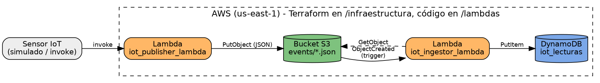
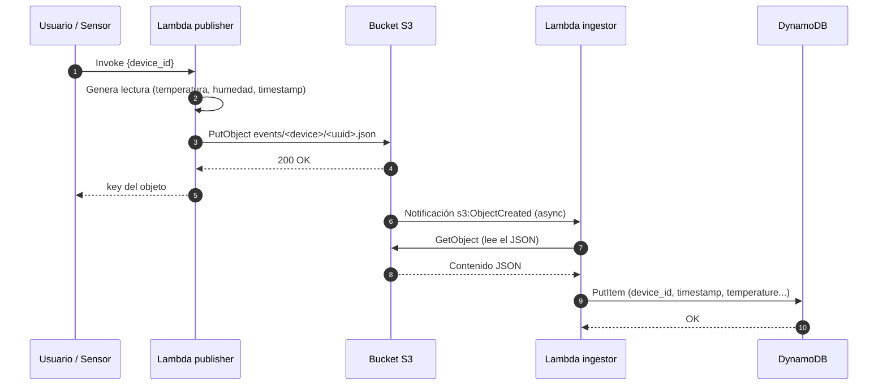

# Pipeline IoT: Lambda → S3 → Lambda → DynamoDB

Una lambda publica una lectura de temperatura (JSON) en S3; el bucket dispara otra lambda que la inserta en DynamoDB.

## Arquitectura



## Flujo de un evento



## Estructura (simula dos repos independientes)

```
infraestructura/   # Terraform: bucket, tabla, lambdas, trigger (comentado en español)
lambdas/           # Código: src/publisher, src/ingestor, tests, deploy.sh
Makefile           # Atajos
```

## Configuración para otra persona

El proyecto se ejecuta **dentro de un contenedor Docker con Linux y Terraform**. Los entornos virtuales (`venv/`, `venv-api/`, `lambdas/.venv/`) **no se suben a Git**: están en `.gitignore` porque son pesados, guardan rutas absolutas y son específicos del sistema operativo (un venv creado en Windows no sirve en Linux: tiene `Scripts/` en vez de `bin/` y ejecutables `.exe`). Lo que se comparte es `requirements.txt`; cada persona **recrea el venv dentro del contenedor**:

```bash
# Dentro del contenedor, desde la raíz del repo:
make venv       # crea venv/ con lambdas/requirements.txt
make test

make api-venv   # crea venv-api/ con api/requirements.txt
source venv-api/bin/activate
cd api && chalice --version
```

Equivalente sin Makefile:

```bash
python3 -m venv venv && venv/bin/pip install -r lambdas/requirements.txt
python3 -m venv venv-api && venv-api/bin/pip install -r api/requirements.txt
```

> Las credenciales de AWS (`~/.aws/credentials`) tampoco se versionan: cada persona configura las suyas. Lo mismo vale para `terraform.tfstate` y `tfplan`.

## Uso

```bash
make help          # lista de comandos
make test          # crea el venv y prueba las lambdas localmente (moto)
make infra-apply   # terraform init + plan + apply
make deploy        # sube el código de ambas lambdas (lambdas/deploy.sh)
make invoke        # dispara el flujo en AWS
make infra-destroy # limpia todo
```

Verificar resultado: `aws dynamodb scan --table-name iot_lecturas --region us-east-1`

> Requiere credenciales del Learner Lab (`~/.aws/credentials`) para infra, deploy e invoke. El rol usado es `LabRole`.
