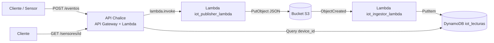
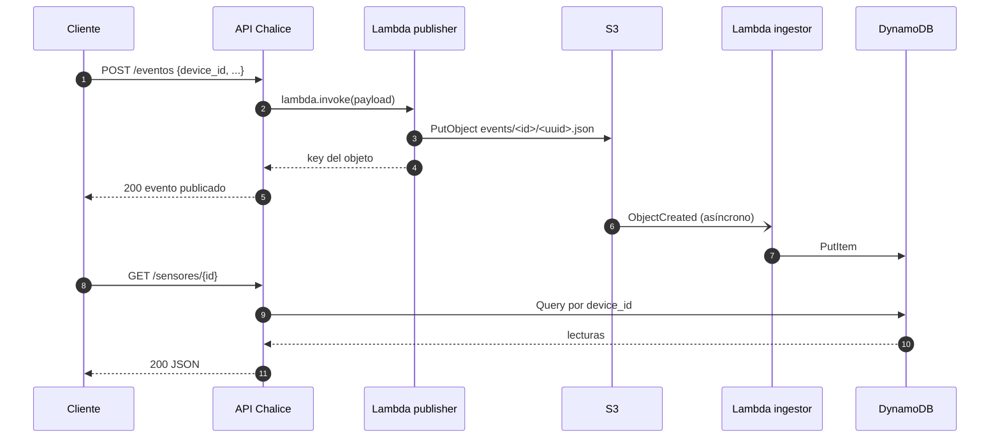

# ToDo: API REST con AWS Chalice

Ya tienen desplegado el flujo **Lambda publisher → S3 → Lambda ingestor → DynamoDB** (ver `README.md`). Falta la puerta de entrada: una **API REST** construida con [AWS Chalice](https://aws.github.io/chalice/).

## Objetivo

Crear una API con **dos endpoints**:

| Método | Ruta | Qué hace |
|---|---|---|
| `POST` | `/eventos` | Recibe el JSON de un sensor (temperatura, humedad, ruido, etc.) e **invoca la lambda `iot_publisher_lambda`** para que continúe el flujo. |
| `GET` | `/sensores/{sensor_id}` | Consulta en DynamoDB (`iot_lecturas`) las lecturas de un sensor por su id. |

## Flujo





> Nota: el `POST` **no escribe** en S3 ni en DynamoDB. Solo invoca a la publisher; el resto del flujo ya existe.

## Qué deben hacer

1. Crear una carpeta `api/` **al mismo nivel** que `infraestructura/` y `lambdas/` (simula un tercer repositorio).
2. Instalar Chalice en un virtualenv y crear el proyecto: `pip install chalice` y `chalice new-project api`.
3. Implementar en `app.py`:
   - **`POST /eventos`**: validar que el body sea JSON y tenga el id del sensor; invocar `iot_publisher_lambda` con `boto3.client("lambda").invoke(...)` y devolver su respuesta (o un error 400 si el body es inválido).
   - **`GET /sensores/{sensor_id}`**: hacer `query` sobre la tabla `iot_lecturas` filtrando por `device_id`, con parámetro opcional `limit`. Convertir los `Decimal` a número antes de responder.
4. Configurar los nombres de recursos (por ejemplo `TABLE_NAME`) con variables de entorno en `.chalice/config.json`.
5. Desplegar con `chalice deploy` y probar con `curl`.
6. Subir un README corto con las instrucciones y un ejemplo de uso.

## Importante: Chalice NO se integra con Terraform

- **No** hay que agregar la API ni su lambda en `infraestructura/`.
- Chalice crea y gestiona por sí mismo la lambda de la API, el API Gateway y su rol (`chalice deploy` / `chalice delete`).
- Terraform sigue siendo dueño únicamente del bucket, la tabla, las lambdas publisher/ingestor y el trigger.
- En el Learner Lab no se pueden crear roles IAM: en `.chalice/config.json` usen `"autogen_policy": false` y `"iam_role_arn"` con el ARN de `LabRole`.

## Sobre el contenido de los eventos

Hoy la lambda publisher genera una lectura simulada y solo acepta sobrescribir `device_id`, `timestamp`, `temperature` y `humidity`. La ingestor exige `temperature`. Para aceptar **cualquier tipo de sensor** (ruido, luz, etc.) deben ajustar ambas lambdas (por ejemplo, un formato `{sensor_id, tipo, valor}`) y volver a desplegar con `make deploy`.

## Criterios de entrega

- [ ] `POST /eventos` dispara la publisher y el dato aparece en DynamoDB.
- [ ] `GET /sensores/{id}` devuelve las lecturas de ese sensor.
- [ ] Respuestas de error claras (400 para datos inválidos).
- [ ] La API vive en su propia carpeta, sin tocar el Terraform.
- [ ] README con ejemplos de `curl`.

## Pruebas sugeridas

```bash
URL=<url que imprime chalice deploy>
curl -X POST $URL/eventos -H 'Content-Type: application/json' \
  -d '{"device_id":"sensor-01","temperature":23.5,"humidity":60}'
curl $URL/sensores/sensor-01
```

Ayuda: [documentación de Chalice](https://aws.github.io/chalice/) y, como referencia, el ejemplo `13_localstack/api_chalice`.

